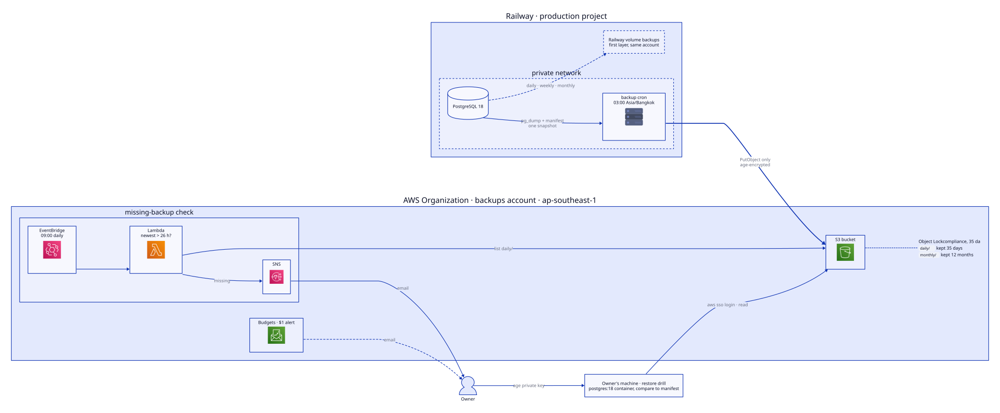

# Production backup diagrams

D2 sources for this feature's diagrams, with each rendered SVG committed
beside its source. Each source sets its own layout engine, light and dark
themes and padding, so one command renders it:

```bash
d2 architecture.d2 architecture.svg
```

The SVG follows the viewer's `prefers-color-scheme`. AWS icons are fetched
from `icons.terrastruct.com` when rendering and embedded in the SVG.

| Source            | Shows                                                                   |
| ----------------- | ----------------------------------------------------------------------- |
| `architecture.d2` | The nightly job, the S3 bucket and its rules, the alert, and the drill. |


