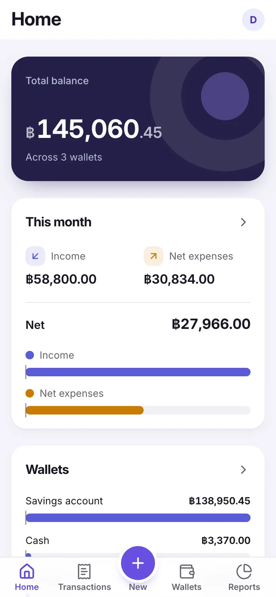
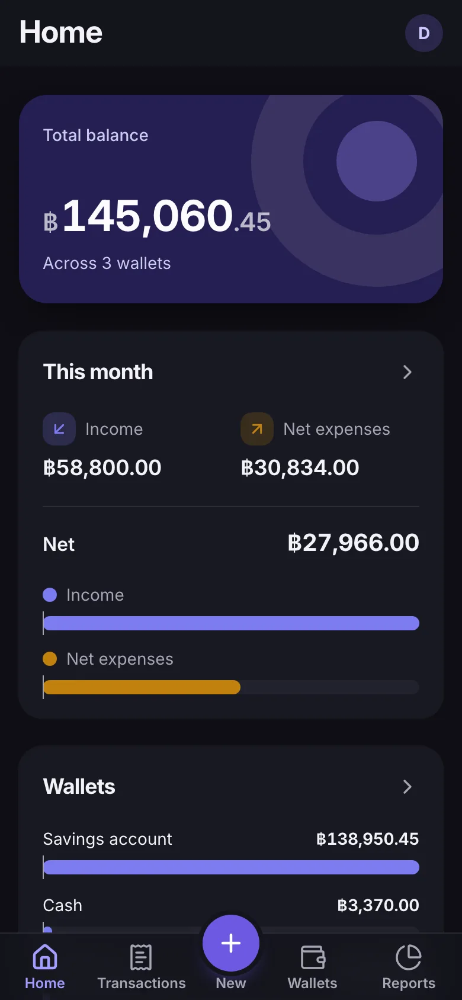
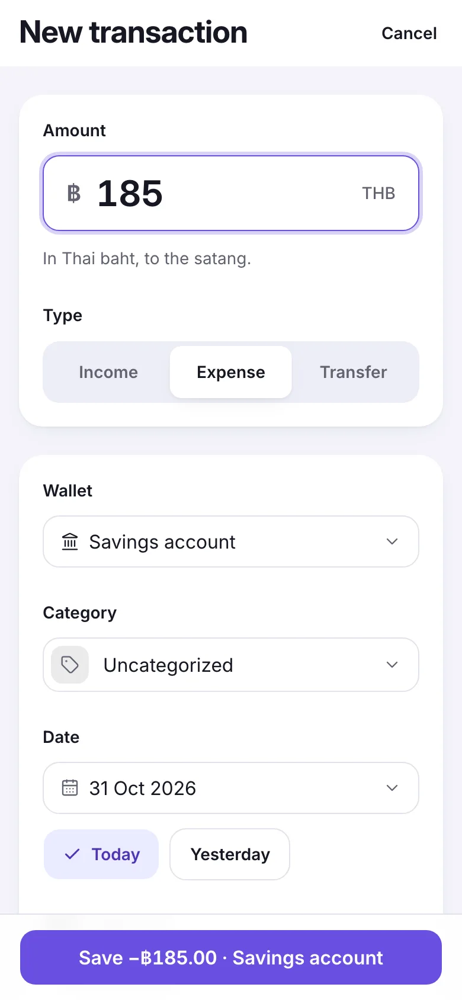
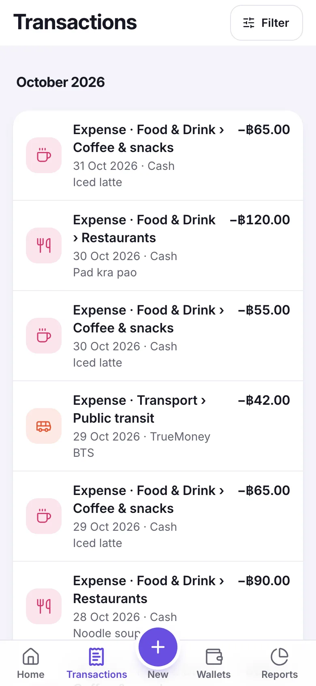
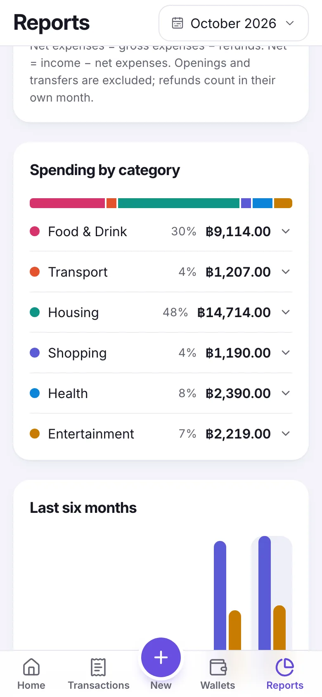
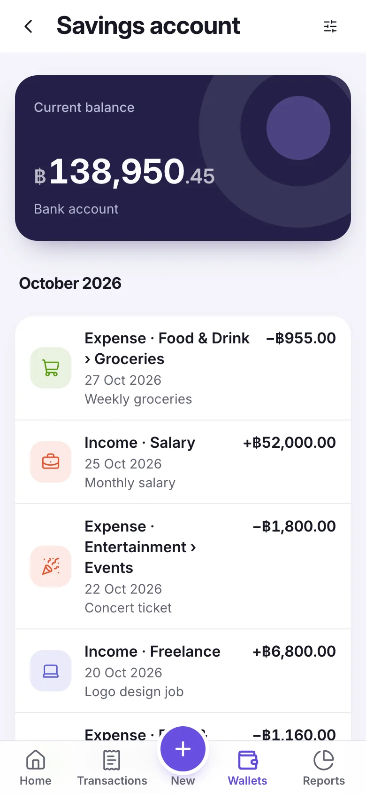
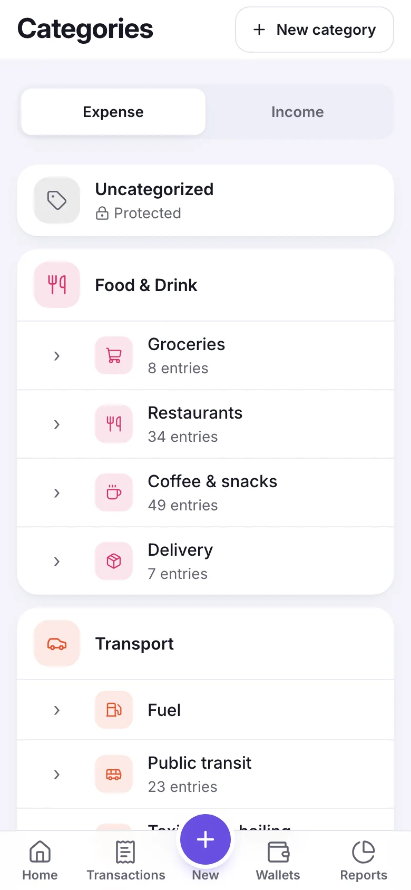

# Bookkeeping

A phone-first personal ledger for recording household money the moment it
moves: what came in, what went out, and where it sits now. Every entry is made
by hand; there's no bank sync.

  

I used to keep household money in a spreadsheet, and the finance apps I tried
in its place kept getting in the way. Most made me leave the entry screen just
to add a category. So I built my own: a ledger I trust enough to keep, where
balances reconcile with reality and corrections leave an honest history. I've
kept my real ledger in it since September 2026.

## What it does

- **Wallets** for cash, bank accounts, and e-wallets. Each starts from a dated
  opening balance, and its balance on any date comes from its transactions.
- **Income and expenses** in exact Thai baht, to the satang, filed under
  two-level categories. A missing category can be created without leaving the
  entry screen, and a new entry starts on the last-used wallet.
- **Transfers** between your own wallets, recorded once and applied to both.
- **Refunds** against a specific expense. A refund can't exceed the expense's
  unrefunded amount, and it reduces category spending in the month the refund
  is dated.
- **Debt payments and card cash advances** recorded as ordinary cash movements:
  a card bill is an expense from the wallet that paid it, and a cash advance is
  income into the wallet that received it.
- **Reports** for any month: income, net expenses, spending by category, a
  six-month trend, and every wallet's balance on a chosen date.
- **Corrections** that edit or delete a transaction in place, while an internal
  change history keeps what it looked like before.
- **An installable app** with light and dark appearance, built for one-handed
  entry right after paying, and still comfortable for review on a desktop.
  It's supported in Chrome and Edge on Android and desktop
  ([ADR 0007](docs/adr/0007-chromium-only-browser-support.md)).

Each Account's data is isolated from every other Account's; there's no
sharing.

## Screenshots

<table>
  <tr>
    <td align="center"> Home, dark</td>
    <td align="center"> Recording an expense</td>
    <td align="center"> Transaction history</td>
  </tr>
  <tr>
    <td align="center"> Spending by category</td>
    <td align="center"> A wallet's history</td>
    <td align="center"> Categories</td>
  </tr>
</table>

The screenshots show a fictional demo Account.

## How it's built

- **A single-page app and an API.** A Vite and TanStack Router client,
  installable as a PWA, calls a Hono API on Node.js
  ([ADR 0006](docs/adr/0006-vite-tanstack-router-spa-client.md),
  [ADR 0003](docs/adr/0003-hono-application-backend.md)). TypeScript
  throughout, in a pnpm and Turborepo monorepo
  ([ADR 0002](docs/adr/0002-turborepo-monorepo.md)).
- **One contract, generated API types.** API routes describe their requests
  and responses with Zod schemas, the server generates an OpenAPI document from
  them, and the client's types are generated from that document.
- **Rules live with the use cases.** Domain, application, database, and auth
  code sit in shared packages, and each business rule is enforced by the
  operation that owns it, proven by integration tests against real PostgreSQL
  ([ADR 0004](docs/adr/0004-shared-backend-package-graph.md),
  [ADR 0005](docs/adr/0005-owned-invariants-over-tactical-ddd.md)).
- **Balances are derived, never stored.** A wallet's balance is its opening
  balance plus its transactions up to a date
  ([ADR 0001](docs/adr/0001-transaction-derived-balances.md)).
- **Exact money.** Amounts are stored and calculated in integer satang and sent
  as exact decimal strings over HTTP.
- **Gated deploys.** `main` accepts changes only through pull requests that pass
  CI and the browser suite; Railway then deploys and applies committed database
  migrations before the new API starts
  ([ADR 0010](docs/adr/0010-protected-main-and-gated-deploys.md),
  [ADR 0014](docs/adr/0014-production-migrations-in-railway-pre-deploy.md)).
- **Backups that leave the host.** A nightly job encrypts a database dump and
  stores it in AWS S3, with a rehearsed restore
  ([ADR 0013](docs/adr/0013-nightly-encrypted-backups-to-aws-s3.md)).

The domain vocabulary is in [CONTEXT.md](CONTEXT.md), and every architecture
decision is recorded in [docs/adr/](docs/adr/).

## Later, maybe

Budgeting and forecasting are on the long-term list, but they aren't planned
any time soon.

## Development

- [Setup](docs/development/setup.md): local setup, environment configuration,
  database commands, and production containers
- [Workflow](docs/development/workflow.md): Git workflow, checks, and
  dependency updates
- [Architecture](docs/development/architecture.md): project structure and
  package ownership
- [Testing](docs/development/testing.md): unit, integration, and browser
  tests, and local SonarQube
- [Operations](docs/development/operations.md): production hosting, backups,
  and recovering a locked-out Account
- [Diagrams](docs/development/diagrams.md): the diagram kit
- [Code conventions](docs/code-conventions.md): naming, vocabulary ownership,
  and house-style enforcement
